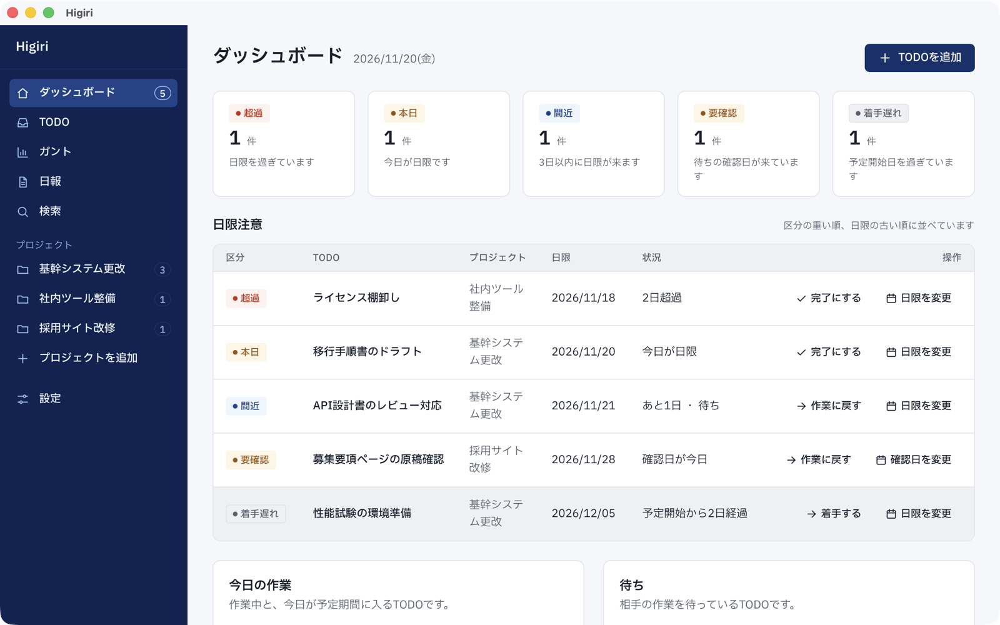
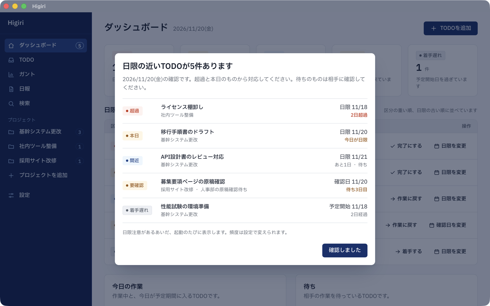
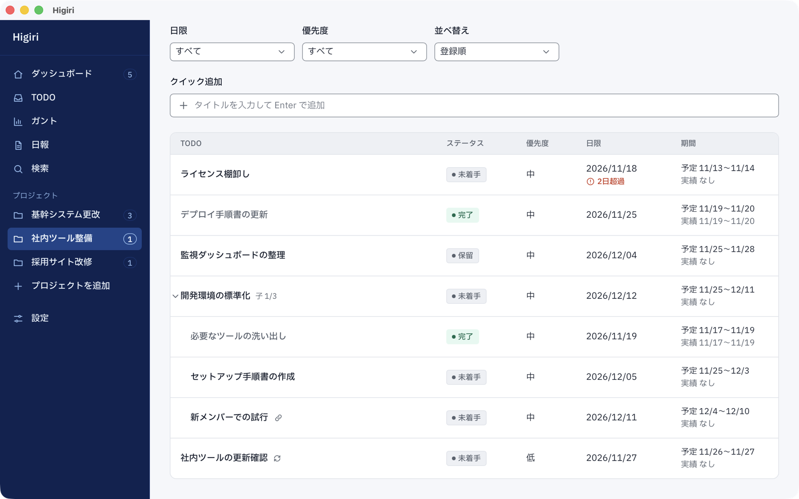
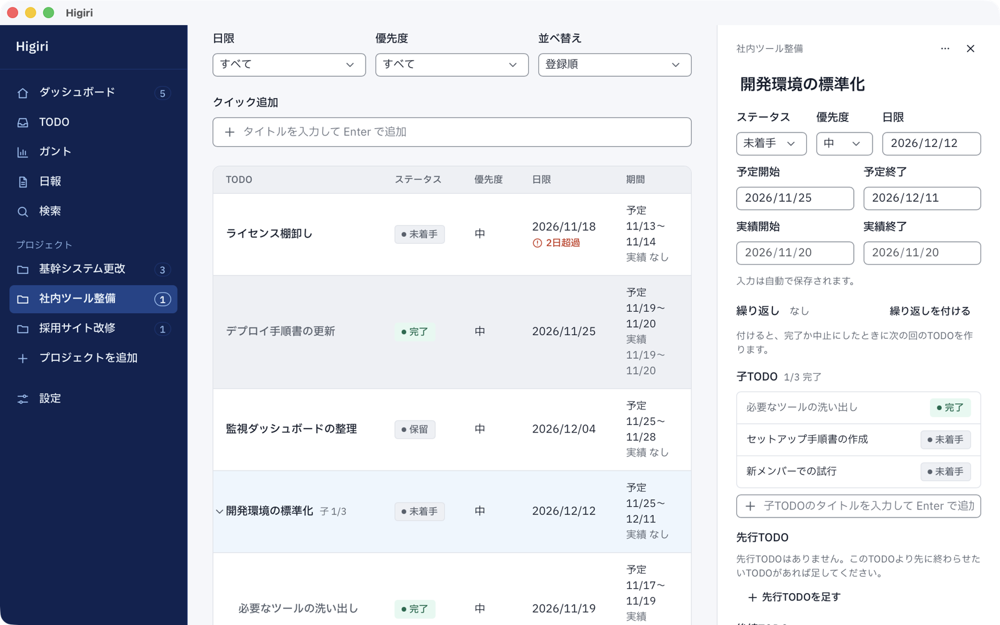
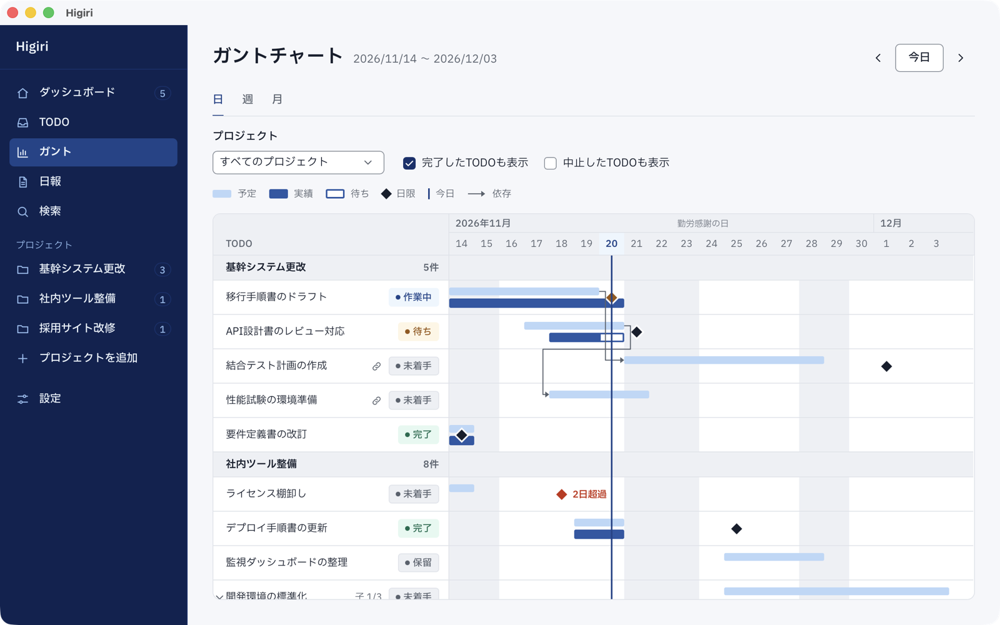
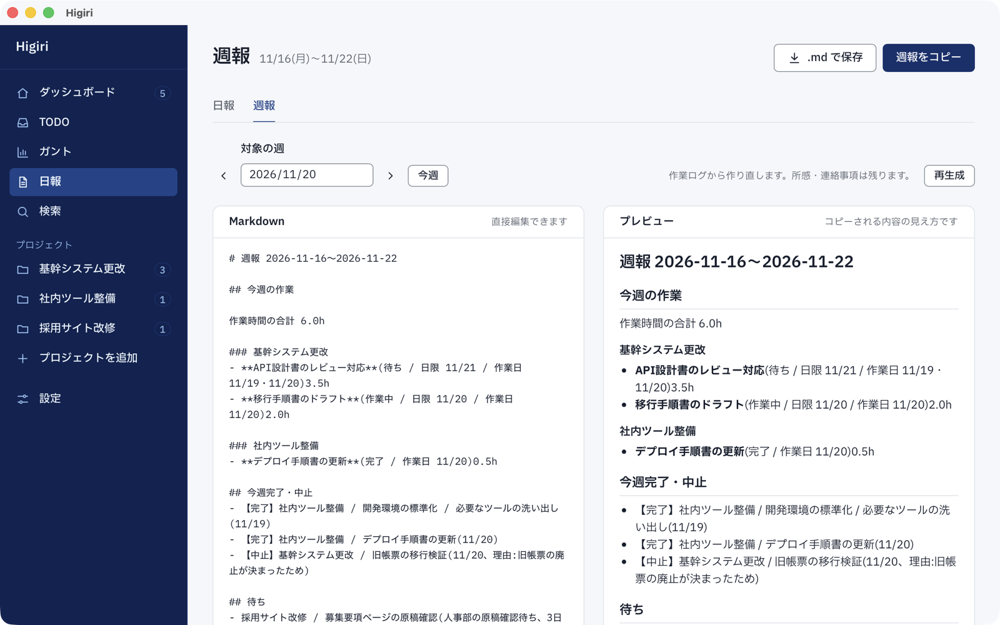

# Higiri

プロジェクト単位で TODO を管理し、日限が近いものに起動直後に気づけるデスクトップアプリです。データはこの PC の中だけに保存し、外部とは通信しません。Windows と macOS で動きます。



## できること

- プロジェクトと TODO の管理(日限、予定・実績の期間、6つのステータス)
- 子TODO。TODO の下に1段だけ子を持てます。親の行に「子 2/3」のように進み具合を出し、一覧とガントで親ごとに折りたためます
- TODO のテンプレート。子TODO を含む一式を名前を付けて保存し、「TODOを追加」で選ぶと入力を省けます。親の日限を入れると、子の日限も決まります
- 繰り返しの TODO(毎日、毎週、毎月、毎年、N日ごと)。完了か中止にすると、次の回の TODO を作ります
- TODO の間の依存(先に終わらせる「先行TODO」と、それを待つ「後続TODO」)。先行TODO が終わっていないことと、予定の前後の食い違いを知らせ、ガントでは矢印で結びます
- 起動時のリマインドと、日限注意をまとめたダッシュボード
- ガントチャート(予定のバーはドラッグで動かせます。両端で伸び縮みもできます)
- Markdown のメモと作業ログ
- 日報と週報(月曜〜日曜)の作成、コピー、.md での保存。節の並び、見出し、出す節、添える項目はテンプレートで変えられます
- TODO の検索(タイトル、メモ、待っている相手、中止の理由、作業ログから探します)
- 日数の数え方を「暦日」と「営業日」から選べます。営業日では、土日、日本の祝日、自分で足した休日(年末年始など)を除いて数えます
- 決まった時刻(初めは 9:00 と 12:55)に、日限注意の件数を OS の通知で知らせます
- トレイへの常駐。ウィンドウを×で閉じてもトレイ(macOS はメニューバー)に残り、終了はトレイのメニューの「終了」から行います
- PC にログインしたときの自動起動(ウィンドウを出さずにトレイだけで起動します)
- 毎日の自動バックアップと、バックアップからの復元
- 全データの JSON での書き出しと取り込み(取り込むと今のデータは置き換わり、取り込む前の状態は復元の一覧から戻せます)

## 画面

画面の画像は、サンプルデータで動かしたものです。

### 起動時のリマインド

起動すると、日限の近い TODO をまとめて知らせます。



### TODO の一覧

子TODO は親の下に字下げして並び、親の行に「子 1/3」のような進み具合を出します。鎖の印は先行TODO が終わっていない TODO、回る矢印の印は繰り返しの TODO です。



### TODO の詳細

詳細パネルで、項目、子TODO、繰り返し、先行TODO・後続TODO、メモ、作業ログを扱います。



### ガントチャート

予定と実績を2段のバーで描き、先行TODO から後続TODO へ矢印を引きます。土日と祝日は網掛けします。



### 週報

日報の画面で「週報」に切り替えると、月曜〜日曜の週報を作れます。左で編集し、右で見え方を確かめます。



## インストール

[Releases](../../releases/latest) から ZIP をダウンロードし、展開して使います。インストーラーはありません。

- Windows(64ビット): `Higiri_<版>_windows_x64.zip`。展開した `Higiri.exe` を実行します。
- macOS(Apple Silicon): `Higiri_<版>_macos_arm64.zip`。展開した `Higiri.app` を「アプリケーション」フォルダに移して開きます。

どちらも有料の署名を受けていないため、初めて開くときに確認が出ます。

- Windows: 「Windows によって PC が保護されました」と出たら、「詳細情報」→「実行」を選んでください。
- macOS: 開けないときは、「システム設定」→「プライバシーとセキュリティ」で「このまま開く」を選んでください。

データはアプリとは別の場所(Windows は `%APPDATA%\com.redjet.higiri`、macOS は `~/Library/Application Support/com.redjet.higiri`)に保存されます。新しい版に入れ替えても、データは残ります。

v0.3.0 で一度開いたデータは、v0.2.0 では開けません(データは消えません)。v0.2.0 に戻すときは、v0.3.0 を初めて開く前の日のバックアップが要ります。v0.3.0 で作ったバックアップと JSON も、v0.2.0 では読み込めません。

### 通知と自動起動

- 通知が届かないときは、OS の通知の設定で Higiri が許可されているかを確かめてください。設定画面の「通知を試す」で、通知が届くかを確かめられます。
- 「PCにログインしたときに起動する」は、設定画面でオン・オフします。
  - macOS では、`Higiri.app` を「アプリケーション」フォルダに移してからオンにしてください。ダウンロードした場所から直接開いているとオンにできません。
  - Windows では、`Higiri.exe` を別の場所に移したら、一度そこから起動してください。自動起動の登録が新しい場所に変わります。
  - Windows では、オンの間は起動のたびに登録し直します。タスクマネージャーの「スタートアップ」で無効にしても次の起動で有効に戻るので、止めるときは設定画面でオフにしてください。

## 開発

Node.js 24、Rust(stable)と、[Tauri の前提ツール](https://v2.tauri.app/start/prerequisites/)が必要です。

```bash
npm install
npm run dev      # ウィンドウを開いて開発する
npm run check    # 型チェック、書式の確認、テスト、lint
npm run build    # 配布用の ZIP を release/ に作る
```

要件・設計・画面モックは `docs/` にあります。

リリースは、版のタグを push すると GitHub Actions が Windows 版と macOS 版の ZIP を作り、Releases に置きます。

```bash
git tag v0.1.0
git push origin v0.1.0
```

## ライセンス

MIT ライセンスです。ただし、Aizome デザインシステム(`docs/aizome/` と `src/components/aizome/`)は対象外です。詳しくは [LICENSE](LICENSE) を見てください。
