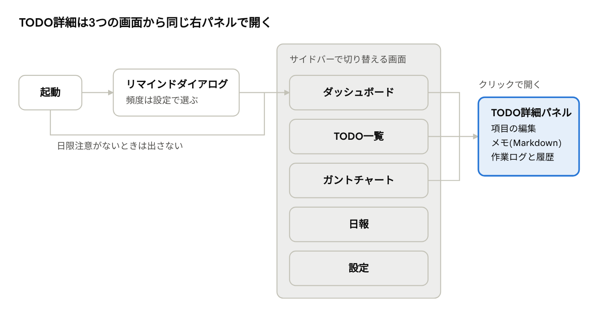

# TODO管理デスクトップアプリ 要件定義・設計書

2026-11-19 時点の写し。原本は claude.ai 上のドキュメント「TODO管理デスクトップアプリ 要件定義・設計書」。

v1.1の詳細(「v1.1の詳細」の節と、各節にあるv1.1の記述)は、このリポジトリの写しに足したもので、claude.ai の原本には入っていない。v1.1については、この写しを正とする。

## 概要と前提

プロジェクト単位でTODOを管理し、日限が危ないものに起動直後に気づける、ローカル完結のデスクトップアプリをTauri 2で作る。

ねらいは3つ。

- 日限の見落としをなくす(起動時のリマインドとダッシュボード)
- 予定と実績のずれを見えるようにする(予定期間・実績期間とガントチャート)
- 日々の作業記録をそのまま日報にする(Markdownの作業ログから自動生成)

想定ユーザーは、複数のプロジェクトを並行して抱える個人。要望に書かれていない点は次の仮定を置いた。

| 項目 | 置いた仮定 | 仮定が違う場合の影響 |
| --- | --- | --- |
| 利用形態 | 1人・1台で使い、データはPC内にだけ保存する | 複数人で共有するならサーバーと認証が必要になり、設計が大きく変わる |
| 対応OS | Windowsを主対象とし、macOSでもビルドできる構成にする | Linux対応を加えても設計は変わらない(動作確認の対象が増える) |
| 表示言語 | 日本語のみ | 多言語化するなら文言を辞書ファイルに分離する |
| 日付の粒度 | 日限・予定・実績はすべて日単位で、時刻は持たない | 時刻まで管理するならDBの型とガントの目盛りが変わる |
| 休日の扱い | 残り日数は暦日で数える(土日祝も1日)。v1.1で、暦日と営業日を設定で切り替えられるようにする。初期値は暦日(利用者が決定) | 営業日の数え方は「v1.1の詳細」の「営業日での日数」にある。祝日は規則から計算するので、データの取り込みは要らない |
| 日報の出力先 | Markdownテキストをクリップボードにコピー、または.mdファイルに保存 | メールやチャットへの直接送信は対象外 |

## 機能要件

要望を41の要件に分解した。「段階」は後述のリリース段階に対応する。

### プロジェクト

| ID | 要件 | 段階 |
| --- | --- | --- |
| P-1 | プロジェクトを作成・編集・削除できる。項目は名前、色、説明 | MVP |
| P-2 | プロジェクトごとに、TODOの完了数/総数と日限注意の件数を表示する | MVP |
| P-3 | 終わったプロジェクトはアーカイブできる。一覧・ダッシュボード・ガントから外れ、後から戻せる | MVP |

### TODO

| ID | 要件 | 段階 |
| --- | --- | --- |
| T-1 | TODOをプロジェクトに属する形で登録・編集・削除できる。項目はタイトル、ステータス、優先度、日限、予定期間(開始・終了)、実績期間(開始・終了)、メモ | MVP |
| T-2 | ステータスは「未着手」「作業中」「待ち」「保留」「完了」「中止」の6つ | MVP |
| T-3 | 「作業中」にすると実績開始日、「完了」にすると実績終了日に当日を自動で入れる。手で直せる | MVP |
| T-4 | 一覧をステータス・日限・優先度で絞り込み、並べ替えできる | MVP |
| T-5 | 一覧の入力欄にタイトルを打ってEnterで、すぐ追加できる | MVP |
| T-6 | 予定終了日が日限より後になる入力には警告を出す | MVP |
| T-7 | タイトル・メモ・作業ログを横断して全文検索できる | v1.1 |
| T-8 | 他の担当者の作業を待つTODOは「待ち」にする。待っている相手と、次に確認する日(確認日)を記録する。待ちに入った日は自動で入る | MVP |
| T-9 | 外部の事情で不要になったTODOは、削除せず「中止」にして理由を残す。中止したTODOは一覧の「中止」タブから見られる | MVP |

### Markdownでの記録

「作業状況」と「履歴」を別の入れ物に分ける。メモは今の状況を1枚にまとめる場所、作業ログは日付つきで積み上げる場所で、日報は作業ログから作る。

| ID | 要件 | 段階 |
| --- | --- | --- |
| M-1 | TODOごとに「メモ」(現在の作業状況や概要)をMarkdownで書ける | MVP |
| M-2 | TODOごとに「作業ログ」を追記できる。1件は日付、Markdown本文、作業時間(任意)からなる | MVP |
| M-3 | 編集とプレビューを切り替えられる。表、チェックボックス、コードブロックに対応する | MVP |
| M-4 | 入力は自動保存する(入力が止まってから1秒後) | MVP |
| M-5 | ステータス・日限・期間の変更を自動で記録し、作業ログと同じ時系列に並べて表示する | MVP |

### ガントチャート

| ID | 要件 | 段階 |
| --- | --- | --- |
| G-1 | TODOごとに予定期間と実績期間を2段のバーで表示し、日限をマーカーで示す | MVP |
| G-2 | 今日の位置に縦線を引き、土日は背景色で区別する | MVP |
| G-3 | 表示単位を日・週・月で切り替え、プロジェクトで絞り込める。完了と中止のTODOは表示・非表示を切り替えられる | MVP |
| G-4 | 作業中・待ちで実績終了日が空のTODOは、実績バーを今日まで伸ばして表示する | MVP |
| G-5 | バーをクリックするとTODO詳細を開く | MVP |
| G-6 | バーのドラッグで予定期間を変更できる | v1.1 |
| G-7 | 待ちの期間は、実績バーの中で白抜きにして区別する | MVP |

### 日報

| ID | 要件 | 段階 |
| --- | --- | --- |
| R-1 | 指定した日(初期値は今日)の日報をMarkdownで生成する。内容は、その日の作業ログ、その日に完了・中止したTODO、待ちの状況、翌日の予定、日限注意 | MVP |
| R-2 | 生成結果をその場で編集でき、「所感・連絡事項」を書き足せる | MVP |
| R-3 | クリップボードへのコピーと、.mdファイルへの保存ができる | MVP |
| R-4 | 保存した日報は日付から呼び出せる | MVP |
| R-5 | 日報の見出し構成と出力項目をテンプレートとして変更できる | v1.1 |

### ダッシュボードとリマインド

| ID | 要件 | 段階 |
| --- | --- | --- |
| D-1 | 起動して最初に出る画面をダッシュボードにする。日限注意のTODOを「超過」「本日」「間近」「要確認」「着手遅れ」に分けて最上部に出す。要確認は、確認日が来た待ちのTODO | MVP |
| D-2 | 起動時に日限注意が1件以上あれば、件数と一覧をリマインドダイアログで出す。出す頻度は「起動のたび」と「1日1回」から設定で選べる。初期値は起動のたび。アプリを開いたまま日付が変わったときも、起動時と同じ扱いにする | MVP |
| D-3 | ダッシュボードの日限注意から、その場で完了にする・日限や確認日を変える・待ちから作業に戻す・詳細を開く、ができる | MVP |
| D-4 | 「間近」とみなす日数(初期値3日)と、確認日の初期値(待ちにした日の3日後)を設定で変えられる | MVP |
| D-5 | 作業中のTODOと、今日が予定期間に入る未着手のTODOを「今日の作業」として並べる。待ちと保留は入れない | MVP |
| D-6 | OSの通知でも日限注意の件数を知らせる | v1.1 |
| D-7 | PCログイン時に自動起動してトレイに常駐する。ウィンドウを閉じていても日限注意に気づける | v1.1 |
| D-8 | 待ちのTODOを、待っている相手・待ち日数・確認日つきで並べる | MVP |

### 将来の機能とデータ管理

| ID | 要件 | 段階 |
| --- | --- | --- |
| S-1 | TODOの下に子TODOを持てる。親の進捗は子の完了率で示し、ガントでは親子を折りたためる | 将来 |
| S-2 | 作業時間をタイマーで計測し、見積と実績を比べられる。日報と週報に時間の集計を載せる | 将来 |
| C-1 | その日最初の起動時にデータベースを自動バックアップし、7日分を残す(v1.1では、常駐中に日付が変わったときにも取る) | MVP |
| C-2 | 全データをJSONでエクスポート・インポートできる | v1.1 |

## 非機能要件

ネットワークなしで全機能が動き、データを失わないことを最優先にする。性能の数値は提案値。

| 項目 | 要件 |
| --- | --- |
| 性能 | TODO 5,000件・作業ログ 20,000件の状態で、起動からダッシュボード表示まで2秒以内、一覧とガントの操作応答は0.1秒以内を目標にする。v1.1の検索と、営業日の設定での判定も0.1秒以内を目標にする |
| オフライン | 全機能がネットワークなしで動く。アプリから外部へデータを送らない |
| データ保全 | 変更は都度SQLiteにコミットする。Markdownは自動保存する。その日最初の起動時にDBファイルをバックアップし、7日分を残す。v1.1では、常駐中に日付が変わったときにも、その日のバックアップを取る |
| セキュリティ | Tauriの権限設定で、画面側から呼べるコマンドとプラグイン機能を必要なものだけに絞る。Markdown内のHTMLは無害化して表示する。リンクはOSの既定ブラウザで開く |
| 多重起動 | 同時に動くのは1つだけ。2つ目を起動したら既存のウィンドウを前面に出す(v1.1では、自動起動による2つ目の起動ならウィンドウを出さない) |
| 操作性 | 主要操作にキーボードショートカットを割り当てる(新規TODO、画面切り替え、検索)。ウィンドウの位置と大きさを次回起動時に復元する。ライト/ダークの配色を持つ |
| 保守性 | 日限の判定と日報生成はRust側に置き、単体テストを書く。DBの構造変更はマイグレーションファイルで版管理する |
| 配布 | Windows・macOSとも、実行ファイル(Windowsは`Higiri.exe`、macOSは`Higiri.app`)をZIPにして配る。インストーラーと.dmgは作らない(フェーズ8で利用者の指示により変更)。自動アップデートは将来の検討項目とする |

## リリース段階

3段階に分け、MVPだけで「毎日これ1本で回せる」状態にする。サブTODOは将来対応だが、データ構造だけはMVPから備えておく。

| 段階 | 入れるもの | 状態の目安 |
| --- | --- | --- |
| MVP (v1.0) | プロジェクト、TODO(日限・予定/実績期間、待ちと中止を含む6つのステータス)、Markdownのメモと作業ログ、ダッシュボードと起動時リマインド、ガント(表示のみ)、日報(生成・コピー・保存)、自動バックアップ | 要望のうち、サブTODOと時間管理以外がすべて使える |
| v1.1 | OS通知、自動起動とトレイ常駐、ガントのドラッグ編集、日報テンプレート、全文検索、営業日での残り日数計算、JSONエクスポート/インポート | アプリを開かなくても日限に気づける |
| 将来 (v2) | サブTODO、時間管理(タイマー、見積と実績の比較)、週報・月報、TODO間の依存関係、繰り返しTODO | 大きな作業の分解と、時間の振り返りができる |

v1.1の7つの要件の仕様は「v1.1の詳細」の節に、作業の順番と完了条件は `implementation-plan-v1.1.md` にある。

サブTODOへの備えとして、TODOテーブルに親を指す列をMVPから持たせる。後から画面を足すだけで済み、既存データの移行が要らない。

週報・月報への備えとして、日報の保存先を期間つきのreportsテーブルにしておく。時間管理はテーブルの追加だけで入れられるので、今は備えを置かない。

## アーキテクチャと技術スタック

画面(WebView)は表示と入力だけを担い、データの読み書きと判定ロジックはすべてRust側のコマンドに集める。


画面から見えるのはコマンドだけ。日限注意の判定などのロジックはドメイン層の純粋関数にまとめ、単体テストの対象にする。

### 技術スタック

| 層 | 採用するもの | 選んだ理由 |
| --- | --- | --- |
| アプリ基盤 | Tauri 2(2026年11月時点の最新は2.12.6、[リリース一覧](https://v2.tauri.app/release/)) | 指定どおり |
| 画面 | React 19 + TypeScript + Vite | UI部品に使うAizomeがReact向けのため(Aizomeの部品が使うAPIはReact 19でも変わらないことを確認済み)。Markdownエディタなど周辺部品もそろっている |
| UI部品 | Aizome(利用者のデザインシステム)のトークンとReact部品 | ボタン、表、タブ、ダイアログ、サイドナビなど14部品をそのまま使える。ガントなど足りない部品は同じトークンで作る |
| 画面側のデータ取得 | TanStack Query | コマンド結果のキャッシュと、更新後の再取得を任せられる |
| Markdown編集 | CodeMirror 6 | 軽く、キー操作や記法の色分けを拡張で足せる |
| Markdown表示 | react-markdown + remark-gfm + rehype-sanitize | 表とチェックボックスに対応し、HTMLを無害化できる |
| ガント描画 | 自前のSVG描画 | 予定/実績の2段バーと日限マーカーという表示は単純で、外部ライブラリに合わせるより自作が早い。サブTODOの階層表示も後から自由に作れる |
| バックエンド | Rust(Tauriコマンド) | Tauriの標準構成 |
| データベース | SQLite + sqlx | 1ファイルで完結し、バックアップがファイルコピーで済む。マイグレーションをアプリに同梱できる |
| 型の共有 | tauri-specta | Rustのコマンド定義からTypeScriptの型を生成し、画面側との食い違いを防ぐ |

公式のsqlプラグインは画面側からSQLを発行する方式のため、今回は使わない([プラグイン一覧](https://v2.tauri.app/ja/plugin))。日限の判定や日報生成をRustに集めてテストしたいので、Rust側でsqlxを直接使う。

### 使うTauri公式プラグイン

| プラグイン | 用途 | 段階 |
| --- | --- | --- |
| single-instance | 多重起動を防ぎ、既存ウィンドウを前面に出す | MVP |
| window-state | ウィンドウの位置と大きさを復元する | MVP |
| dialog | 日報の保存先を選ぶ。v1.1では、JSONの書き出し先と、取り込むファイルも選ぶ | MVP |
| clipboard-manager | 日報をクリップボードにコピーする | MVP |
| opener | Markdown内のリンクを既定ブラウザで開く | MVP |
| log | 動作ログをファイルに残す | MVP |
| notification | OS通知で日限注意を知らせる。Rustからだけ使い、画面側には権限を付けない | v1.1 |
| autostart | PCログイン時に自動起動する。Rustからだけ使い、画面側には権限を付けない | v1.1 |

ファイルへの書き出し(日報の.md、バックアップ、v1.1のJSON)と、v1.1のJSONの読み込みはRust側のコマンドで行い、画面側にファイル操作の権限を渡さない。dialogもRust側から開くので、画面側には権限を付けない。

v1.1のトレイは、プラグインではなくTauri本体のtray-iconの機能で作る。

## データモデル

テーブルは6つ。中心はtodosで、作業ログと変更履歴がそこにぶら下がる。

| テーブル | 役割 | 関係 |
| --- | --- | --- |
| projects | プロジェクト | todosの親 |
| todos | TODO本体。日限、予定期間、実績期間、メモ(Markdown)、待ちと中止の項目を持つ | projectsに属する。parent_idで自分自身を指せる |
| work_logs | 作業ログ。日付つきのMarkdown | todosに属する。日報の材料になる |
| todo_events | ステータス・日限・期間の変更履歴(自動記録) | todosに属する。「本日完了」の抽出と、待ち日数の集計に使う |
| reports | 保存した日報と、手で書いた所感。週報・月報も同じ形で入る | 種類と期間の開始日が主キー |
| settings | 設定値(リマインドの頻度、間近の日数、確認日の初期値、最後にリマインドした日、配色など) | キーと値 |

### テーブル定義

```sql
CREATE TABLE projects (
  id          INTEGER PRIMARY KEY,
  name        TEXT NOT NULL,
  color       TEXT NOT NULL DEFAULT '#3B6FD4',
  description TEXT NOT NULL DEFAULT '',
  sort_order  INTEGER NOT NULL DEFAULT 0,
  archived_at TEXT,                        -- NULL = 稼働中
  created_at  TEXT NOT NULL,
  updated_at  TEXT NOT NULL
);

CREATE TABLE todos (
  id             INTEGER PRIMARY KEY,
  project_id     INTEGER NOT NULL REFERENCES projects(id) ON DELETE CASCADE,
  parent_id      INTEGER REFERENCES todos(id) ON DELETE CASCADE,  -- サブTODO用。MVPでは常にNULL
  title          TEXT NOT NULL,
  status         TEXT NOT NULL DEFAULT 'todo'
                 CHECK (status IN ('todo', 'doing', 'waiting', 'hold', 'done', 'cancelled')),
  priority       INTEGER NOT NULL DEFAULT 2,  -- 1=高 2=中 3=低
  due_date       TEXT,                        -- 日限
  planned_start  TEXT,                        -- 予定期間
  planned_end    TEXT,
  actual_start   TEXT,                        -- 実績期間
  actual_end     TEXT,
  waiting_on     TEXT,                        -- 待ち:誰・何を待っているか
  waiting_since  TEXT,                        -- 待ち:待ちに入った日(自動)
  follow_up_date TEXT,                        -- 待ち:次に確認する日(確認日)
  closed_at      TEXT,                        -- 完了・中止にした日時
  close_reason   TEXT,                        -- 中止の理由
  memo_md        TEXT NOT NULL DEFAULT '',    -- メモ(現在の作業状況)
  sort_order     INTEGER NOT NULL DEFAULT 0,
  created_at     TEXT NOT NULL,
  updated_at     TEXT NOT NULL,
  CHECK (planned_start IS NULL OR planned_end IS NULL OR planned_start <= planned_end),
  CHECK (actual_start  IS NULL OR actual_end  IS NULL OR actual_start  <= actual_end)
);
CREATE INDEX idx_todos_project   ON todos(project_id, status);
CREATE INDEX idx_todos_due       ON todos(due_date) WHERE status NOT IN ('done', 'cancelled');
CREATE INDEX idx_todos_follow_up ON todos(follow_up_date) WHERE status = 'waiting';
CREATE INDEX idx_todos_parent    ON todos(parent_id);

CREATE TABLE work_logs (
  id         INTEGER PRIMARY KEY,
  todo_id    INTEGER NOT NULL REFERENCES todos(id) ON DELETE CASCADE,
  log_date   TEXT NOT NULL,                -- 作業した日
  body_md    TEXT NOT NULL,
  minutes    INTEGER,                      -- 作業時間(任意)
  created_at TEXT NOT NULL,
  updated_at TEXT NOT NULL
);
CREATE INDEX idx_work_logs_date ON work_logs(log_date);
CREATE INDEX idx_work_logs_todo ON work_logs(todo_id, log_date);

CREATE TABLE todo_events (
  id          INTEGER PRIMARY KEY,
  todo_id     INTEGER NOT NULL REFERENCES todos(id) ON DELETE CASCADE,
  event_date  TEXT NOT NULL,               -- 発生した日
  kind        TEXT NOT NULL,               -- 'created' | 'status' | 'due_date' | 'planned' | 'actual' | 'follow_up'
  old_value   TEXT,
  new_value   TEXT,
  note        TEXT,                        -- 待ちの相手、中止の理由など
  occurred_at TEXT NOT NULL
);
CREATE INDEX idx_todo_events_date ON todo_events(event_date);
CREATE INDEX idx_todo_events_todo ON todo_events(todo_id);

CREATE TABLE reports (
  kind         TEXT NOT NULL CHECK (kind IN ('daily', 'weekly', 'monthly')),
  period_start TEXT NOT NULL,              -- 日報はその日、週報は週の初日
  period_end   TEXT NOT NULL,
  body_md      TEXT NOT NULL,              -- 保存時点の全文
  note_md      TEXT NOT NULL DEFAULT '',   -- 所感・連絡事項(手入力)
  updated_at   TEXT NOT NULL,
  PRIMARY KEY (kind, period_start)
);

CREATE TABLE settings (
  key   TEXT PRIMARY KEY,
  value TEXT NOT NULL                      -- JSON
);
```

### 決めごと

- 日付は `YYYY-MM-DD` の文字列(PCのローカル日付)、日時はUTCのISO 8601文字列で持つ。文字列の大小比較がそのまま日付の前後になる。
- 接続時に外部キー制約とWALモードを有効にする。
- プロジェクトを削除すると配下のTODOと記録も消える。通常はアーカイブを使い、削除には確認を挟む。
- ステータスの種類はCHECK制約で縛る。SQLiteでは制約を後から変えるとテーブルの作り直しになるため、待ちと中止は最初から入れておく。
- reportsは種類(daily / weekly / monthly)と期間の開始日で1行が決まる。MVPで使うのはdailyだけで、開始日と終了日が同じになる。
- reportsで所感を本文と別に持つのは、作業ログを足して再生成しても手で書いた所感を残すため。
- todo_eventsのnoteは常にJSONのオブジェクトで持つ。old_value / new_value とnoteの形、noteのキーの一覧は、リポジトリ直下の `CLAUDE.md` の「データの決めごと」にある。
- サブTODOを入れるときはparent_idに親のidを入れるだけでよい。子は親と同じプロジェクトに属する、という制約はアプリ側で守る。
- 時間管理を入れるときは、開始・終了時刻を持つtime_entriesテーブルと、todosの見積時間の列を足す。work_logsのminutesはそのときtime_entriesへ移す。既存テーブルの作り直しは要らない。
- v1.1でもテーブル定義は変えない(マイグレーションを足さない)。v1.1で増える値はすべてsettingsのキーに入れ、検索は既存の列を `LIKE` で引く。

### settingsのキー

1キー1行で、値はJSON。読めない値は既定値として扱う。

| キー | 値 | 既定値 | 段階 |
| --- | --- | --- | --- |
| `reminder_frequency` | `"every_launch"` / `"once_per_day"` | `"every_launch"` | MVP |
| `soon_days` | 数値(間近とみなす日数) | `3` | MVP |
| `follow_up_days` | 数値(確認日の初期値。待ちにした日のN日後) | `3` | MVP |
| `last_reminded_on` | `"YYYY-MM-DD"` か `null` | `null` | MVP |
| `theme` | `"light"` / `"dark"` / `"system"` | `"light"` | MVP |
| `day_count` | `"calendar"`(暦日) / `"business"`(営業日) | `"calendar"` | v1.1 |
| `custom_holidays` | `[{name, start, end, yearly}]` | `[]` | v1.1 |
| `notify_enabled` | 真偽(OSの通知を出すか) | `true` | v1.1 |
| `notify_times` | `["HH:MM", …]`(1〜5個) | `["09:00", "12:55"]` | v1.1 |
| `last_notified_at` | UTCの日時(`2026-11-19T00:00:00.000Z` の形)か `null` | `null` | v1.1 |
| `close_to_tray` | 真偽(×ボタンでトレイに残すか) | `true` | v1.1 |
| `autostart` | 真偽(PCログイン時に起動するか) | `false` | v1.1 |
| `tray_hint_shown` | 真偽(トレイの案内を出したか) | `false` | v1.1 |
| `report_template` | 日報テンプレートの構造(「日報テンプレート」の節) | 今の日報と同じ形 | v1.1 |

- `last_reminded_on`、`last_notified_at`、`tray_hint_shown` はアプリが書く値で、`update_settings` の入力には入れない(設定画面の保存で古い値に戻さないため)。
- バックアップからの復元とJSONの取り込みでは、PCごとの値の `autostart` と、アプリが書く値の `last_notified_at`、`tray_hint_shown`、`last_reminded_on` を、今の値のまま残す(v1.1)。
- `custom_holidays` の1件は `{name, start, end, yearly}`。`start` と `end` は最初の年の日付で、`yearly` なら毎年くり返す(12/29〜翌1/3 のように年をまたげる)。名前は空にできず30字まで、`start <= end`、長さは31日まで。
- `notify_times` は `HH:MM` の形で1〜5個、重複なし。
- `report_template` の題名は空にできない。節の見出しは空にできず40字まで。

## 主要ロジック

日限注意の判定を1つの関数にまとめ、ダッシュボード・リマインド・一覧のバッジ・日報のすべてで同じ結果を使う。

### 日限注意の判定

対象は「完了」「中止」以外のTODO。上の行から順に調べ、最初に当てはまった区分にだけ出す。

| 区分 | 条件 | 表示(Aizomeの状態色) |
| --- | --- | --- |
| 超過 | 日限が今日より前 | 朱(danger) |
| 本日 | 日限が今日 | 琥珀(warning) |
| 間近 | 日限が明日からN日後まで(Nは設定値、初期値3) | 藍(info) |
| 要確認 | ステータスが待ちで、確認日が今日以前 | 琥珀(warning) |
| 着手遅れ | ステータスが未着手で、予定開始日が今日より前 | 無彩色(neutral) |

色だけに頼らず、区分名を必ず文字で添える。

区分内の並びは、日限の古い順、次に優先度の高い順。これとは別に、一覧とガントでは次の2つを小さな警告アイコンで示す。

- 計画が間に合わない:予定終了日が日限より後
- 予定超過:作業中または待ちで、予定終了日が今日より前

実装はRustの純粋関数 `classify(todo, today, soon_days)` とし、今日の日付を引数で渡す。日付の境界(当日、N日後ちょうど、月またぎ)を単体テストで固められる。

v1.1では、営業日で数えられるように `classify(todo, today, &rules)` にする。`rules` は間近の日数(`soon_days`)と、休日の暦(`WorkCalendar`)を持つ。判定がこの1か所であることは変えない。営業日の設定で変わる点は「v1.1の詳細」の「営業日での日数」にある。暦日の設定では、上の表のまま判定する。

### ステータスの遷移と実績日の自動入力


開いている4状態(未着手・作業中・待ち・保留)の間は自由に行き来できる。完了と中止は、そのどの状態からでも選べる。完了と中止の間を直接行き来することはできない。完了から戻せるのは作業中(再開)だけ、中止から戻せるのは未着手だけ。

| 行き先 | 自動で行うこと |
| --- | --- |
| 作業中にする | 実績開始日が空なら今日を入れる。待ちから来た場合は待ちの3項目を空に戻す。完了から来た場合(再開)は実績終了日とclosed_atを空に戻す |
| 待ちにする | 待っている相手と確認日を入力させ、待ち開始日に今日を入れる。確認日の初期値は3日後(設定で変更可) |
| 保留にする | 日付は変えない。待ちから来た場合は待ちの3項目を空に戻す |
| 完了にする | 実績終了日に今日、closed_atに現在時刻を入れる。実績開始日が空なら開始日にも今日を入れる。待ちの3項目は空に戻す |
| 中止にする | 理由を入力させ、closed_atに現在時刻を入れる。実績開始日があれば実績終了日に今日を入れる。待ちの3項目は空に戻す |
| 未着手に戻す | 中止から戻す場合はclosed_at、理由、実績終了日を空に戻す。それ以外は日付を変えない |

どの遷移もtodo_eventsに1行記録する。自動で入った日付は詳細パネルで手直しできる。

### 待ちと中止の扱い

- 「保留」は自分の判断で止めている状態、「待ち」は相手にボールがある状態として分ける。
- 待ちの間も日限は止めない。超過・本日・間近は待ちのままでも出し、「待ち」と添える。
- 確認日が来た待ちは「要確認」として出す。相手に確認してまだ待つ場合は、確認日だけを先に延ばす。
- 中止は削除と区別する。TODOも作業ログも残り、一覧の「中止」タブから見られる。
- 完了と中止は閉じた状態とし、日限注意と「今日の作業」から外す。
- プロジェクトの進捗は、中止を除いた件数を分母にする。
- 待ちに入った日と抜けた日はtodo_eventsに残るので、待ち日数は後から集計できる。

### 起動時リマインド

1. 画面の起動時に `get_startup_reminder` を呼ぶ。
2. 設定の「リマインドの頻度」が「1日1回」のときだけ、今日の日付と「最後にリマインドした日」を比べ、同じなら何も返さない。「起動のたび」のときはこの比較を飛ばす。
3. 日限注意を集計し、1件以上あれば区分ごとの一覧を返す。画面はダッシュボードの上にリマインドダイアログを出す。
4. ダイアログを閉じたら `ack_reminder` で今日の日付を保存する。

頻度の初期値は「起動のたび」。どちらの設定でも、日限注意が0件ならダイアログは出さない。ダッシュボードの日限注意欄は、ダイアログの有無に関係なく常に表示する。アプリを開いたまま日付が変わる場合に備え、ウィンドウが前面に来たときに日付の変化を調べ、変わっていたらダッシュボードを更新して手順2からやり直す。

v1.1では、これとは別に、決まった時刻(初期値は毎日9:00と12:55)にOSの通知で日限注意の件数を知らせる。1分おきの監視はしない。常駐してウィンドウを閉じている間に日付が変わった場合も、ウィンドウを出して前面に来たときに、上と同じく日付の変化を調べる。通知の時機は「v1.1の詳細」の「常駐とOSの通知」にある。

### 日報の生成

対象日を1つ受け取り、6つの節を組み立ててMarkdownを返す。

| 節 | 拾うもの |
| --- | --- |
| 本日の作業 | 対象日の作業ログ。プロジェクト、TODOの順にまとめ、TODOのステータス・日限・作業時間を添える。ログの本文はTODOの下に字下げしてそのまま入れる |
| 本日完了・中止 | 対象日に「完了」「中止」へ変わり、今もその状態のTODO。中止には理由を添える |
| 待ち | 対象日の時点で待ちのTODO。相手、待ち日数、確認日を添える |
| 明日の予定 | 作業中のTODOと、予定開始日が翌日以前の未着手TODO |
| 日限注意 | 対象日を「今日」として判定した超過・本日・間近 |
| 所感・連絡事項 | 手で書いた内容(再生成しても消えない) |

v1.1では、節の並び、見出し、出す/出さない、添える項目をテンプレートで変えられる(「v1.1の詳細」の「日報テンプレート」)。既定のテンプレートでは、上の表と下の出力例のまま出す。営業日の設定では、「明日の予定」は次の営業日の予定になり、日限注意の日数は「あとN営業日」「N営業日超過」と書き、休日に当たる日限には「休日のため前倒し」と添える。

出力例:

```markdown
# 日報 2026-11-19(木)

## 本日の作業

### 基幹システム更改
- **API設計書のレビュー対応**(待ち / 日限 11/20)1.5h
  - 指摘12件のうち9件を反映
  - 残り3件は認証まわり。認証担当に質問を送り、回答待ち
  - [ ] 指摘10:トークン更新の手順を追記
- **移行手順書のドラフト**(作業中 / 日限 11/19)2.0h
  - 切り戻し手順の章を書き終え、レビューを依頼した

### 社内ツール整備
- **デプロイ手順書の更新**(完了)0.5h
  - 新しい承認フローに合わせて手順4〜6を書き換えた

## 本日完了・中止
- 【完了】社内ツール整備 / デプロイ手順書の更新
- 【中止】基幹システム更改 / 旧帳票の移行検証(理由:旧帳票の廃止が決まったため)

## 待ち
- 採用サイト改修 / 募集要項ページの原稿確認(人事部の原稿確認待ち、3日目、確認日 11/19)
- 基幹システム更改 / API設計書のレビュー対応(認証担当の回答待ち、1日目、確認日 11/20)

## 明日の予定
- 基幹システム更改 / 移行手順書のドラフト
- 基幹システム更改 / 結合テスト計画の作成(予定 11/20〜11/27)
- 基幹システム更改 / 性能試験の環境準備(予定 11/17〜11/20)
- 社内ツール整備 / ライセンス棚卸し(予定 11/12〜11/13)

## 日限注意
- 【超過】社内ツール整備 / ライセンス棚卸し(日限 11/17、2日超過)
- 【本日】基幹システム更改 / 移行手順書のドラフト(日限 11/19)
- 【間近】基幹システム更改 / API設計書のレビュー対応(日限 11/20、あと1日、待ち)

## 所感・連絡事項
- 移行手順書は今日が日限。レビュー結果を受けて、明日の午前に確定する。
```

### ガントの描画

- 1行が1つのTODOで、プロジェクトごとにまとめて並べる。上段に予定(淡い色)、下段に実績(濃い色)のバーを描く。
- 待ちの期間は、実績バーのその区間を白抜きにする。区間はtodo_eventsの待ち開始と終了から求める。
- 日限はひし形のマーカーで示し、日限注意の区分色を付ける。
- 横軸の1日の幅は、日表示32px、週表示12px、月表示4px。初期表示は、今日が左から3分の1ほどの位置に来る範囲にする。
- 期間が未入力のTODOは、バーなしで行と日限マーカーだけを出す。
- 完了したTODOは既定で表示し、中止したTODOは既定で隠す。どちらもチェックボックスで切り替える。
- 行数が多いときは、画面に見えている行だけを描く。
- v1.1では、祝日と独自の休日も土日と同じく網掛けし、見出しにその日の名前を出す(暦日の設定でも)。予定のバーはドラッグで動かせる(「v1.1の詳細」の「ガントのドラッグ編集」)。

## 画面構成

画面は6つとダイアログ1つ。左のサイドバーで切り替え、TODO詳細はどの画面からでも右側のパネルとして開く。

画面モックは `ui-mock/` にある(原本は claude.ai 上の「TODO管理アプリ UIデザイン」)。Aizomeのトークンと部品で、ダッシュボード、起動時リマインド、TODO一覧と詳細パネル、ガントチャート、日報、設定の6枚を描いた。



日報と設定からは詳細パネルを開かない。リマインドダイアログは、日限注意があるときにダッシュボードの上に出る。出す頻度は設定で「起動のたび」か「1日1回」を選ぶ。

| 画面 | 役割 | 主な操作 |
| --- | --- | --- |
| ダッシュボード | 起動時に最初に出る。日限注意と今日の作業を見る | 完了にする、日限を変える、詳細を開く |
| リマインドダイアログ | 起動時に日限注意を知らせる。頻度は設定で選ぶ | 確認して閉じる |
| TODO一覧 | プロジェクト別、または全プロジェクト横断でTODOを並べる | クイック追加、絞り込み、並べ替え、ステータス変更 |
| TODO詳細パネル | 1件のTODOの項目、メモ、作業ログを編集する | 日限・期間の編集、Markdown編集、ログ追加 |
| ガントチャート | 予定と実績を時間軸で見る | 表示単位の切り替え、絞り込み、バーから詳細を開く |
| 日報 | 指定日の日報を生成し、編集して出す | 日付選択、再生成、コピー、保存 |
| 設定 | リマインドの頻度、間近の日数、確認日の初期値、配色、バックアップを扱う | 値の変更、バックアップからの復元 |

v1.1では次のものを足す。どれもモックはなく、Aizomeの部品とトークンで既存の画面に合わせて作る。

- 検索ダイアログ。Ctrl+Fと、サイドナビの「検索」で開く。「検索」は画面ではないので、画面の切り替えには加えない。
- 設定画面のカード。「通知と常駐」「日数の数え方」「日報のテンプレート」を足し、「データ」のカードにJSONの書き出しと取り込みを足す。
- JSONの取り込みの確認ダイアログ。
- ガントのドラッグ中の表示(バーの位置と日付)。

### キーボードショートカット

| 操作 | キー |
| --- | --- |
| 新規TODO | Ctrl+N |
| 画面切り替え(ダッシュボード、TODO、ガント、日報) | Ctrl+1 〜 Ctrl+4 |
| 検索ダイアログを開く(v1.1) | Ctrl+F |
| 詳細パネルを閉じる | Esc |
| 作業ログを追加(ログ入力欄で) | Ctrl+Enter |
| 編集とプレビューの切り替え | Ctrl+E |

macOSではCtrlをCommandに読み替える。

## コマンドAPIとディレクトリ構成

画面側が呼べるのは次のコマンドだけで、SQLもファイル操作も画面側には置かない。

| 分類 | コマンド | 補足 |
| --- | --- | --- |
| プロジェクト | `list_projects` `create_project` `update_project` `archive_project` `delete_project` | 一覧は完了数/総数と日限注意の件数を含めて返す |
| TODO | `list_todos` `get_todo` `create_todo` `update_todo` `change_status` `delete_todo` | `list_todos` は絞り込み条件を受け、日限注意の区分を付けて返す。`change_status` は待ちの相手・確認日や中止の理由も受け取り、実績日の自動入力と履歴記録を1トランザクションで行う |
| 作業ログ | `list_timeline` `save_work_log` `delete_work_log` | `list_timeline` は作業ログと変更履歴を時系列に混ぜて返す |
| ダッシュボード | `get_dashboard` `get_startup_reminder` `ack_reminder` | 日限注意の5区分、今日の作業、待ち、プロジェクト別の進捗 |
| ガント | `get_gantt` | 表示期間とプロジェクトを受け、行データを返す |
| 日報 | `generate_report` `save_report` `get_report` `export_report_file` | 生成、保存、呼び出し、.mdへの書き出し。種類(日報・週報)と期間を引数に取る |
| 設定 | `get_settings` `update_settings` | |
| バックアップ | `list_backups` `restore_backup` `open_data_folder` | 復元の前に今のデータを退避する。`open_data_folder` は設定画面の「データフォルダを開く」(フェーズ8で追加) |
| 検索(v1.1) | `search_todos` | T-7。語を受け取り、当たったTODOと、当たった場所・前後の文を返す。最大100件と、全体の件数 |
| 休日(v1.1) | `list_holidays` | 期間(3年まで)を受け取り、休日(祝日と独自の休日、名前つき)を返す。ガントの網掛けと設定画面の確認に使う |
| JSON(v1.1) | `export_data` `import_data` | C-2。保存先と取り込むファイルのダイアログはRust側で開く。`import_data` は検査してから全データを置き換える |
| 通知(v1.1) | `test_notification` | 設定画面の「通知を試す」 |

v1.1で足すコマンドは上の5つだけ。自動起動、×ボタンの動き、通知の時刻、日報テンプレートは `update_settings` で扱う。OS側への反映(自動起動の登録、通知のタイマーの計算し直し)は `#[tauri::command]` の層で行い、内側の関数はDBだけを扱う。

### ディレクトリ構成

```text
todo-app/
├─ src/                        # 画面(React + TypeScript)
│  ├─ app/                     # ルーティングと共通レイアウト(サイドバー、詳細パネル)
│  ├─ features/
│  │  ├─ dashboard/            # ダッシュボード、リマインドダイアログ
│  │  ├─ projects/
│  │  ├─ todos/                # 一覧、詳細パネル、Markdownエディタ、タイムライン
│  │  ├─ gantt/                # SVG描画、目盛り計算
│  │  ├─ report/
│  │  └─ settings/
│  ├─ components/              # 共通UI部品
│  └─ lib/
│     ├─ bindings.ts           # tauri-spectaが生成するコマンドと型
│     └─ date.ts
├─ src-tauri/
│  ├─ src/
│  │  ├─ lib.rs                # プラグイン登録、コマンド登録、起動処理
│  │  ├─ commands/             # #[tauri::command] の薄い層
│  │  ├─ domain/               # urgency.rs / status.rs / report.rs(純粋関数)
│  │  ├─ repo/                 # SQL(sqlx)
│  │  └─ backup.rs
│  ├─ migrations/              # 0001_init.sql ...
│  ├─ capabilities/default.json
│  └─ tauri.conf.json
└─ package.json
```

### テストの置き場所

- `domain/`:Rustの単体テスト。日限注意の判定、ステータス遷移、日報の組み立てを、日付を引数で渡して検証する。
- `repo/`:メモリ上のSQLiteにマイグレーションを当てて検証する。
- 画面:Vitestでガントの座標計算など、計算を含む部分を検証する。

## v1.1の詳細

この節は、このリポジトリの写しに足したもので、claude.ai の原本には入っていない。v1.1の7つの要件(D-6、D-7、G-6、R-5、T-7、営業日での日数、C-2)の仕様をまとめる。作業の順番と完了条件は `implementation-plan-v1.1.md` にある。

テーブル定義は変えない(マイグレーションを足さない)。新しい値はすべてsettingsのキー(「データモデル」の「settingsのキー」)に入れる。

### 利用者が決めたこと

| 項目 | 決定 |
| --- | --- |
| 休日 | 土日と日本の祝日を規則から計算する。独自の休日(年末年始など)は設定画面で足せる |
| 営業日の範囲 | 間近の判定、「あとN日」「N日超過」、着手遅れの日数、確認日の初期値(N営業日後)。待ち日数は暦日のまま。設定で暦日と営業日を切り替え、初期値は暦日 |
| 休日に当たる日限 | 前の営業日に寄せる。金曜に見て日曜が日限なら「本日」。表示する日付は日曜のままで「休日のため前倒し」と添える |
| ×ボタン | 隠してトレイに残す。設定で「閉じたら終了」にも切り替えられる。初期値は「トレイに残す」 |
| 通知の時機 | 毎日9:00と12:55(設定で変更・追加できる)。PCが止まっていて時刻を過ぎていたら、起動時か復帰時に1回だけ出す。日限注意が0件なら出さない。1分おきの監視はしない |
| Windowsの通知登録 | まずHKCUのレジストリにAUMIDを登録する方法を実機で試す。だめならスタートメニューにショートカットを作る |
| JSONの取り込み | 全部を置き換える(復元と同じく、先に今のデータを退避する) |
| 日報テンプレート | 節の並び、見出し、出す/出さない、添える項目を設定画面で選ぶ。行の書式は今のまま |
| 検索の入口 | 検索ダイアログ。Ctrl+F(macOSはCommand+F)とサイドナビの「検索」で開く |
| ガントのドラッグ | バーの移動と、左右の端での伸び縮み。1日単位で吸着し、Escで取り消す。対象は開いている4状態だけ |
| 常駐中のバックアップ | 日付が変わったら取る。常駐のタイマーが起きたときに日付が変わっていたら、その日のバックアップを取る。起動時と同じく1日1個で、7個残す |

### 設計で決めたこと

利用者の決定をもとに、設計の側で決めたこと。違っていれば直す。

| 項目 | 決定 |
| --- | --- |
| 通知とウィンドウ | 通知は、ウィンドウが前面にあるかどうかに関係なく出す |
| トレイの中身 | トレイには件数を出さない(画面を閉じている間に古くなるため)。メニューは「Higiri を開く」「終了」の2つ |
| 自動起動したとき | ウィンドウを出さず、トレイだけで起動する |
| 待ちに関する日数 | 待ち日数と、確認日からの経過日数は、営業日の設定でも暦日で数える |
| 経過日数が0になるとき | 休日に見たときなど、営業日で数えると経過日数が0になる場合(超過、着手遅れ)は「1日」と出す |
| ガントの休日 | 祝日と独自の休日は、暦日の設定でもガントで網掛けする |
| 独自の休日 | 「名前、開始日〜終了日、毎年くり返すか」で登録する。祝日を出勤日に変える機能は作らない |
| 検索の方式 | SQLiteのFTS5を使わず `LIKE` で引く。FTS5のtrigramは3文字未満の語を引けず、「認証」のような2文字の語で困るため。性能はperfテストで確かめる(目標0.1秒) |
| 復元・取り込みで残す値 | バックアップからの復元とJSONの取り込みのどちらでも、PCごとの値の `autostart` と、アプリが書く値の `last_notified_at`、`tray_hint_shown`、`last_reminded_on` は、今の値のまま残す |
| 取り込みの前の退避 | 復元の退避(`before-restore-…`)と同じ仕組みを使う。一覧での表示名は「復元・取り込みの前の状態」にする |
| 通知を試す | 設定画面に「通知を試す」ボタンを置く(Windowsで通知が届くかを確かめる手段) |
| 9:00を過ぎてから手で起動したとき | リマインドのダイアログとOSの通知が両方出る(「過ぎていたら1回出す」に従う) |
| 0件だった時刻 | 日限注意が0件だった時刻も「通知済み」として扱う。その後に件数が増えても、次の時刻まで出さない |
| トレイの案内 | 初めて×で隠したときに1回だけ、トレイで動いていることと、終了はトレイのメニューから行うことを通知で知らせる |
| 通知を止めたとき | `notify_enabled` がオフでも、トレイの案内と「通知を試す」は出す。案内は通知の時機の設定とは別のもの、「通知を試す」はOSの通知が届くかを確かめるもの、という扱い |
| 通知の本文 | 0件の区分は出さない。1件以上の区分だけを、区分の順に「・」でつなぐ(「超過1・本日2」) |
| 通知のクリック | 使う版のプラグインが、デスクトップで通知のクリックに対応していなければ、クリックでは何もしない。ウィンドウはトレイから開く |
| 営業日の表記 | 営業日の設定では、画面と日報の日数に「営業日」と付ける(「あと1営業日」「2営業日超過」「3営業日以内」「3営業日後」) |
| 検索の文字 | 大文字と小文字は区別しない(英字だけ)。全角と半角はそろえない |
| 祝日を計算する年 | 2020〜2099年だけ。今の祝日法の規則(2020年以降のもの。2020・2021年の五輪による移動を含む)で計算し、2019年以前の改正の歴史は入れない(この利用者のデータは2026年から)。その外の年は土日だけを休みとする。春分・秋分の式は、この範囲で使えるものとする |

### 常駐とOSの通知(D-6、D-7)

**起動とウィンドウ**

- ウィンドウは隠した状態で作り、起動の処理で出す。自動起動(`--autostart` の引数つき)のときは出さず、トレイだけで起動する。
- ウィンドウを出すときは、最小化を戻し、表示し、前面に出す。
- ×ボタンは、`close_to_tray` がオン(初期値)なら閉じずに隠してトレイに残し、オフなら終了する。トレイを作れなかったときは、設定にかかわらず隠さずに終了する(開き直す手段がなくなるため)。
- 初めて×で隠したときに1回だけ、次の文を通知し、`tray_hint_shown` を保存する。`notify_enabled` がオフでも出す(通知の時機の設定とは別のものとして扱う)。

  | 題名 | 本文 |
  | --- | --- |
  | Higiri はトレイで動いています | 終了するときは、トレイのメニューから「終了」を選んでください。 |

- macOSでは、Dockのアイコンのクリックでもウィンドウを出す。
- 2つ目の起動では、今までどおり既存のウィンドウを前面に出す。`--autostart` つきの2つ目の起動なら出さない。

**トレイ**

- メニューは「Higiri を開く」「終了」の2つ。件数は出さない。
- Windowsでは、アイコンの左クリックでもウィンドウを開く。
- アイコンは、Windowsはカラーの小さな版、macOSはメニューバー用の単色のテンプレート画像。

**自動起動**

- 設定の「PCにログインしたときに起動する」(`autostart`、初期値はオフ)で切り替える。
- 配布版は、起動のたびに `autostart` の値をOSに反映する。ZIPを置き直すと実行ファイルの場所が変わるので、毎回登録し直す。登録には `--autostart` の引数を付ける(macOSは引数を渡せるLaunchAgentの方式を使う)。
- 開発ビルドではOSに登録しない。設定画面のスイッチも押せないようにし、理由を添える。
- macOSで、App Translocation(ダウンロードしたアプリを隔離された場所で動かすOSの仕組み)の場所から動いているときは登録しない。「自動起動を登録できませんでした。Higiri.app を「アプリケーション」フォルダに移してから、もう一度オンにしてください。」と返す。

**通知の時機**

- 決まった時刻(`notify_times`、初期値は9:00と12:55、1〜5個)に、日限注意の件数をOSの通知で知らせる。設定の「OSの通知を出す」(`notify_enabled`、初期値はオン)で止められる。
- 1分おきの監視はしない。常駐のタイマーは次の時刻まで待つ。待ち時間は最長10分で区切り、起きるたびに時計を見直す(スリープから復帰したあとに時刻を過ぎていたことに気づくため)。
- 時刻が来たら、次の順に動く。
  1. `commands::clock` で時計を読む。
  2. ダッシュボードと同じ集計で、日限注意の件数を出す。
  3. 1件以上なら通知する。0件でも、その時刻は済んだものとして `last_notified_at` を保存する。
- 通知するのは、今日の時刻のうち、今以前で、まだ通知していない最も遅い1つだけ。PCが止まっていて時刻を過ぎていたら、起動時か復帰時に1回だけ出す。前の日の時刻はさかのぼらない。

  | 起動した時刻(時刻は9:00と12:55) | 通知 |
  | --- | --- |
  | 8:59 | 起動時には出さない。9:00に出す |
  | 9:00ちょうど | 9:00の分を出す |
  | 9:30 | 起動時に9:00の分を1回出す。12:55にもう1回出す |
  | 13:00 | 起動時に12:55の分を1回だけ出す(9:00の分は出さない) |

- 通知は、ウィンドウが前面にあるかどうかに関係なく出す。9:00を過ぎてから手で起動したときは、リマインドのダイアログとOSの通知が両方出る。
- 設定を変えたら、タイマーを起こして待ち時間を計算し直す。
- 通知の題名は「日限注意がN件あります」。本文は、1件以上の区分だけを区分の順(超過、本日、間近、要確認、着手遅れ)に「・」でつないだ件数で、0件の区分は出さない。例: 題名「日限注意が3件あります」、本文「超過1・本日2」。
- 通知をクリックしたらウィンドウを出す。使う版のプラグインがデスクトップでこれに対応しているかは、フェーズ10で確かめる。対応していなければ、クリックでは何もしない(ウィンドウはトレイから開く)。
- 設定画面の「通知を試す」(`test_notification`)で、試しの通知を出す。OSの通知が届くかを確かめるためのものなので、`notify_enabled` がオフでも出す。

**常駐中のバックアップ**

- 常駐のタイマーが起きたとき(最長10分おき)に日付が変わっていたら、`backup::run_daily` でその日のバックアップを取る。起動時と同じく1日1個で、新しい順に7個残す。何日も終了せずに常駐していても、自動バックアップが止まらないようにするため。

**復元で残す値**

- バックアップからの復元(`restore_backup`)では、PCごとの値の `autostart` と、アプリが書く値の `last_notified_at`、`tray_hint_shown`、`last_reminded_on` を、今の値のまま残す。JSONの取り込みも同じにする。

**Windowsの通知の登録**

- Windowsのトーストは、アプリの識別子(AUMID)をOSに登録しておかないと、Higiriの名前で出せない。配布版は起動時に、`HKCU\Software\Classes\AppUserModelId\com.redjet.higiri` へ表示名とアイコンのパスを書く。アイコンはデータフォルダにPNGで書き出す。
- 実機でこの方法を試し、通知が出なければ、スタートメニューにショートカットを作る方法に切り替える。

**設定画面「通知と常駐」のカード**

- スイッチ「OSの通知を出す」と、時刻の一覧(足す・消す)
- ボタン「通知を試す」
- スイッチ「ウィンドウを閉じてもトレイに残す」
- スイッチ「PCにログインしたときに起動する」

### 営業日での日数

未決事項の「残り日数は暦日で数えてよいか」への答え。設定の「日数の数え方」(`day_count`)で暦日(`calendar`、初期値)と営業日(`business`)を切り替える。暦日の設定では、今の判定と表示を何も変えない。

**休日**

- 休日は、土日、日本の祝日、独自の休日。
- 祝日は、今の祝日法の規則(2020年以降のもの)から計算する。固定日、ハッピーマンデー、春分・秋分、振替休日、国民の休日と、2020・2021年の五輪による移動を入れる。2019年以前の改正の歴史は入れない。計算するのは2020〜2099年だけで、その外の年は土日だけを休みとする。
- 独自の休日(年末年始など)は設定画面で足す(`custom_holidays`)。1件は「名前、開始日〜終了日、毎年くり返すか」で、年をまたげる(12/29〜1/3)。祝日を出勤日に変える機能は作らない。
- 祝日と独自の休日は、`list_holidays` で名前つきで返す。ガントの網掛けと、設定画面の確認に使う。

**営業日の設定で変わるもの**

| 対象 | 営業日の設定での扱い |
| --- | --- |
| 超過・本日・間近の判定 | 休日に当たる日限を前の営業日に寄せてから、今日と比べる |
| 間近 | 日限がN営業日後まで |
| 「あとN日」 | 今日の次の日から日限までの営業日の数。「あとN営業日」と出す |
| 「N日超過」 | 日限の次の日から今日までの営業日の数。最低1。「N営業日超過」と出す |
| 着手遅れの日数 | 予定開始日の次の日から今日までの営業日の数。最低1。「予定開始からN営業日経過」と出す |
| 確認日の初期値 | 待ちにした日のN営業日後 |
| 日報の「明日の予定」 | 対象日の次の営業日の予定 |
| 一覧の絞り込み「今日まで」 | 前の営業日に寄せた日限で比べる(「7日後まで」は暦日のまま) |
| 待ち日数、確認日からの日数 | 暦日のまま |

- 要確認と着手遅れの条件(確認日が今日以前、予定開始日が今日より前)は変えない。
- 休日に当たる日限は、前の営業日に寄せて判定する。金曜に見て日曜が日限なら「本日」、土曜に見れば「1営業日超過」。土曜に土曜の日限を見ても、金曜に寄せるので「1営業日超過」になる。
- 表示する日付は元の日限(日曜)のままで、画面と日報の両方で「休日のため前倒し」と添える。
- 営業日の設定では、画面と日報の日数に「営業日」と付ける(「あと1営業日」「2営業日超過」、ダッシュボードの「3営業日以内」、確認日の初期値の「3営業日後」)。設定画面の「間近とみなす日数」「確認日の初期値」の単位も「営業日以内」「営業日後」にする。

**判定の関数**

- `classify(todo, today, soon_days)` を `classify(todo, today, &rules)` にする。`rules` は `soon_days` と `WorkCalendar`(数え方と独自の休日)を持つ。判定はこの1か所のまま。
- 判定の結果に、営業日で数えたか(`business_days`)と、休日のため前倒ししたか(`due_shifted`)を足す。画面と日報は、この2つを見て「営業日」と「休日のため前倒し」の文を出す。
- 営業日の数は、週の計算と休日の二分探索で求め、期間の長さに比例しない形にする。
- 確認日の初期値もRust側で計算し、TODOのデータ(`TodoItem`)に入れて返す。画面で日数を足し直さない。

**ガントと設定画面**

- ガントは、祝日と独自の休日も土日と同じく網掛けし(暦日の設定でも)、見出しにその日の名前を出す。
- 設定画面に「日数の数え方」のカードを足す。中身は、暦日か営業日かのラジオボタン、独自の休日の一覧と足す・消す操作、今年の祝日の一覧。

### 全文検索(T-7)

**入口と操作**

- 検索ダイアログで引く。Ctrl+F(macOSはCommand+F)と、サイドナビの「検索」で開く。
- 打った語は200ms待ってから検索する。日本語の変換中は検索しない。
- ↑↓で選び、Enterで開く。
- 選んだTODOは、そのプロジェクトのページ(アーカイブしたプロジェクトなら全体のTODO)に移り、詳細パネルで開く。

**引き方**

- 語を空白(全角の空白も)で分け、すべての語を含むTODOを引く(AND)。
- 対象は、タイトル、メモ、待っている相手、中止の理由、作業ログの本文。アーカイブしたプロジェクトのTODOも含める。
- SQLiteの `LIKE … ESCAPE` で引く。`%` と `_` も文字として引く。英字の大文字と小文字は区別しない。全角と半角はそろえない。

**返すもの**(`search_todos`)

- 最大100件と、全体の件数。100件を超えたら、ダイアログに「100件を超えました。語を足して絞ってください。」と出す。
- 並び順は、タイトルに当たったものが先で、その中は更新の新しい順。
- 1件ごとに、当たった場所と前後の文を返す。
  - 前後の文は、当たった語の前後30字ほど。改行は空白にする。画面で文字数の数え方がずれないよう、当たった語とそれ以外を区切った形(`[{text, hit}]`)で返す。
  - 作業ログは、当たったものをTODOごとに3件まで、日付つきで返す。

性能の目標は0.1秒(TODO 5,000件・作業ログ 20,000件)。

### ガントのドラッグ編集(G-6)

- 予定のバーをドラッグすると、期間の長さを変えずに動かせる。左右の端をつかむと、開始日か終了日だけを伸び縮みさせる。
- 1日単位で吸着する。開始日が終了日を越えないように止める。
- 端をつかむ範囲は、1日の幅が狭い月表示でもつかめる最小幅を取る。
- ドラッグ中は、バーの位置と日付(「11/20〜11/27」)をその場で出す。Escで取り消す。
- 動きが3px未満ならクリックとして扱い、今までどおり詳細を開く。ドラッグのあとのクリックは無視する(詳細を開かない)。
- 対象は、開いている4状態で、予定の開始日と終了日が両方あるTODO。
- 離したら `update_todo` で予定期間を保存する。新しいコマンドは足さない。変更は変更履歴(`planned`)に1行残る。予定終了が日限より後になれば、今ある警告アイコンが出る。
- 保存して一覧を取り直すまでは、新しい位置で描いておく(元の位置に戻って見えないようにするため)。失敗したら元の位置に戻し、エラーの文を出す。
- 詳細パネルを開いたまま同じTODOをドラッグしても、パネルの自動保存がドラッグの結果を打ち消さないようにする。パネルは項目ごとに手で変えたかを持ち、手で変えていない項目は取り直した値を取る。

### 日報テンプレート(R-5)

- 設定画面の「日報のテンプレート」のカードで、節の並び、見出し、出す/出さない、添える項目を選ぶ。行の書式は今のまま。
- テンプレートは `report_template` に入れる。既定のテンプレートでは今の日報と同じものを出し、「日報の生成」の出力例と完全に一致する。
- 題名は `{日付}` と `{曜日}` を差し込める。既定は `日報 {日付}({曜日})`。
- 節は「種類、見出し、出すか、添える項目」の並びで持つ。並びは正規化する。足りない節は既定で補い、重複は除き、所感・連絡事項は常に最後に置く。
- 節ごとに選べる項目は次のとおり。既定は、すべて今の出力と同じ。

  | 節 | 選べる項目 |
  | --- | --- |
  | 本日の作業 | プロジェクトの見出し(出さないときは、行の頭に「プロジェクト名 / 」を付ける)、ステータス、日限、作業時間 |
  | 本日完了・中止 | 中止の理由 |
  | 待ち | 相手、待ち日数、確認日 |
  | 明日の予定 | 予定期間 |
  | 日限注意 | 日数、待ちの印、要確認と着手遅れも含めるか |
  | 所感・連絡事項 | 見出しの文言だけ(常に最後に出す) |

- 所感・連絡事項は、今のテンプレートの見出しと既定の見出しの両方で探す。見出しを変えても、前に書いた所感が消えないようにするため。
- 「初期値に戻す」のボタンで既定に戻す。

### JSONのエクスポートとインポート(C-2)

**書き出す形**

```json
{
  "format": "higiri-export",
  "format_version": 1,
  "schema_version": 1,
  "app_version": "…",
  "exported_at": "…Z",
  "projects": […],
  "todos": […],
  "work_logs": […],
  "todo_events": […],
  "reports": […],
  "settings": {…}
}
```

- 行は列名をキーにし、値は保存されているままにする。settingsの値と `todo_events.note` は、文字列ではなくJSONの値として埋め込む。
- `schema_version` は、適用済みのマイグレーションの最新の番号。読めるのは `format_version` が1のファイルだけ。

**書き出し**(`export_data`)

- 設定画面の「データ」のカードの「JSONで書き出す」。保存先のダイアログをRust側で開き(既定の名前は `higiri-YYYY-MM-DD.json`)、書き出しもRust側だけで行う。

**取り込み**(`import_data`)

設定画面の「データ」のカードの「JSONから取り込む」。全データを置き換える。

1. 画面で「今のデータはすべて置き換わります。取り込む前の状態は残り、復元の一覧から戻せます。」と確認してから、Rust側でファイルを選ぶダイアログを開く。
2. 形式と版を確かめる。新しい版のアプリで書き出したファイルは断る。
3. 作業用のDBにマイグレーションを当てて行を入れ、外部キーとCHECK制約で中身を検査する。
4. 今のデータを `before-restore-<UTC日時>.db` に退避する(復元の退避と同じ。新しい順に3個残す)。
5. 復元と同じ仕組み(ATTACHして、全テーブルの行を1トランザクションで入れ替える)で置き換える。

- PCごとの値の `autostart` と、アプリが書く値の `last_notified_at`、`tray_hint_shown`、`last_reminded_on` は、今の値のまま残す(復元と同じ)。
- 壊れたJSON、新しい版の形式、制約違反のファイルは断り、データを変えない。
- 終わったら案内を出し、復元と同じくすべての一覧を取り直す。
- 退避は、復元の一覧に「復元・取り込みの前の状態」として出す。

## 未決事項

次の6点は仮定を置いて進めた。残り日数の数え方はv1.1で利用者が決め、残る5点は今も仮定のまま進めている。答えが違うものがあれば、該当する要件と設計を直す。

- [ ] 利用は1人・1台でよいか。複数PCでの同期や、他の人との共有は要るか
- [ ] 対象OSはWindowsとmacOSでよいか
- [x] 残り日数は暦日で数えてよいか。営業日(土日祝を除く)で数えたいか → 設定で暦日と営業日を切り替える。初期値は暦日(v1.1、「営業日での日数」)
- [ ] 保留中のTODOも日限注意に出してよいか
- [ ] 作業時間の記録は任意でよいか。日報に時間を載せる必要はあるか
- [ ] 日報はMarkdownのまま提出できるか。メール本文向けのプレーンテキストなど、別の形が要るか
